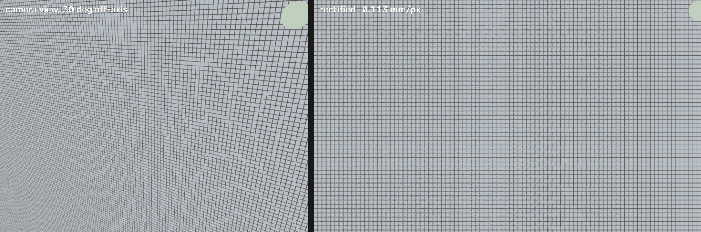

# DepthBed

**A flatbed scanner made from a depth camera.** Point an OAK-D Pro at a part on
a table from any angle; get a rectified photo and a 1:1 DXF outline, ready to
open in CAD.



Depth tells the tool which plane is the table. Undoing the perspective of that
plane is a homography, so the 12 MP photo is rewarped analytically — not
guessed at per pixel. Nothing is detected or segmented: you choose the height
at which the outline is drawn, and you get the contour there.

## Quickstart

```bash
python3 -m venv .venv
.venv/bin/pip install -r requirements.txt

.venv/bin/python -m depthbed                             # preview; SPACE shoots, q quits
.venv/bin/python -m depthbed --once                      # one shot, no window
.venv/bin/python -m depthbed --once --level 2.5
.venv/bin/python -m depthbed --from examples/demo.ocap   # no camera needed
```

Each shot writes one folder:

```
out/20261112-090000/
  outline-1.00mm.dxf   closed polylines, mm, Y up, origin at the photo's
                       lower-left corner
  ortho.png            the rectified photo, same frame and scale
  meta.json            mm_per_px, width_mm, height_mm, level, quality
```

The DXF is already the right size — nothing to scale or rotate. To put the photo
underneath it, insert `ortho.png` at `(0, 0)` with size `width_mm × height_mm`
from `meta.json`; it lines up exactly.

`--level` is your selection: the outline is drawn where the surface crosses
that height above the base plane. One capture, several heights:

```bash
.venv/bin/python -m depthbed --from examples/demo.ocap --level 1
.venv/bin/python -m depthbed --from examples/demo.ocap --level 9
```

If the level is inside the depth noise (a far-away surface), the photo is still
written and the DXF is skipped with a message telling you the level you need.
A level set on noise is not an outline, it is thousands of specks.

## How it works

1. **Find the dominant plane** with RANSAC on the depth map, threshold scaled
   to working range (stereo error grows as z²).
2. **Build the plane frame once**, in the depth camera's frame, then carry it
   into the RGB frame with the calibrated extrinsic. Building it separately in
   each frame offsets the two views by the 37 mm stereo baseline.
3. **Warp the colour image analytically**: point on the plane → real
   projection through the RGB camera (full rational distortion) → one `remap`.
4. **Scatter the 3D surface** onto the same grid for height, from above, so a
   step does not lean sideways. The top surface wins each cell.

## Accuracy

Synthetic ground truth with 1 mm depth noise, RGB and depth cameras 37.5 mm
apart. Markers printed at known plane coordinates, located in the rectified
photo:

| tilt | worst marker error over a ±60 × ±40 mm field |
|---|---|
| 0° | 0.06 mm |
| 4° | 0.10 mm |
| 7° | 0.08 mm |
| 25° | 0.05 mm |

Height on an 8 mm bump reads 8.02 mm. An outline at 6 mm on a 24 mm boss
measures 23.6 mm; at 2 mm on a 50 mm ring, 49.3 mm. Details and limits:
[docs/design.md](docs/design.md).

## Hardware

OAK-D Pro over USB. Once, needs root:

```bash
sudo sh -c 'echo SUBSYSTEM==\"usb\", ATTRS{idVendor}==\"03e7\", MODE=\"0666\" \
  > /etc/udev/rules.d/80-movidius.rules && udevadm control --reload-rules && udevadm trigger'
```

## Tests

```bash
.venv/bin/python tools/selftest.py
```

Rectification against printed markers at four tilts, known heights, known
outline sizes, and a DXF round-trip that re-reads the file it wrote.

## License

MIT. See [LICENSE](LICENSE).
